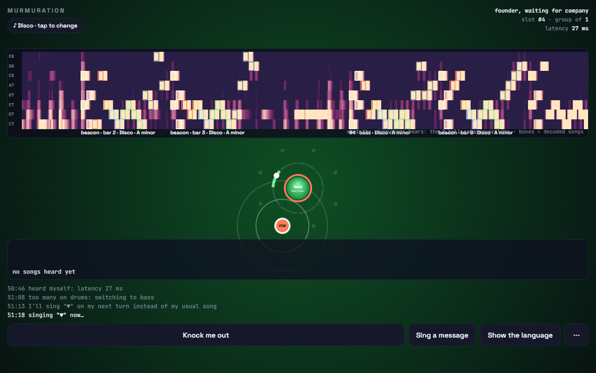

# Murmuration

**A band of phones that talk only through sound. Every chime is data: with no server or conductor they find a shared beat, key and parts by ear, and heal when one drops out.**

Open the page on a few phones and laptops. Each device becomes a musician that chooses its own part, listens to the others through its microphone, and gradually finds the same beat, the same key and a part nobody else is playing. Every chime you hear is a **data packet**: the notes *are* the bits. Press **Knock me out** on one phone: it goes deaf, loses its place and drifts out of time and key. Let it hear again and it finds the band by ear and locks back in. You can *hear* the network heal.

- **Live:** https://murmuration-swarm-4yqs.netlify.app (open on 2+ devices, volume up, tap *Join the swarm*; add `?demo` for a fast start and `?big` to open the spectrogram)
- **Virtual room:** https://murmuration-swarm-4yqs.netlify.app/sim.html (the same agent code running in a simulated room: drag musicians apart, add a wall, scramble everyone's clocks and watch them re-converge)



## Challenges

| Challenge | How Murmuration answers it |
|---|---|
| **Neptune North: Actors work better together** | No hub and no shared clock; sound is the only link. Each actor decides on its own: when to shift its beat, which slot to sing in, which part to play, when to propose a key change. They share one goal, a single coherent piece of music. **When communication fails** (covered mic, carried out of the room, a wall in the simulator), each actor keeps playing on its own clock, and on reconnecting the smaller group merges into the larger one. |
| **DurHack: Composition** | Music composed by a swarm. Nobody writes the piece; it comes out of the agents agreeing a key, a chord progression and parts, with occasional "I fancy a change" mutations, so it keeps evolving. |
| **QRT: Information hidden in plain sight** | A physical language for digital data: an 8-note pentatonic "alphabet" (C7–E8) in which each melody carries 19 bits plus a CRC. The *timing* of the song is information too: it carries the sender's beat without a single bit being sent. **You can text by song:** *Sing a message* sends 3 characters inside a chime, and every device that hears it shows it and sings it on once, so it hops across the room. A live spectrogram (*Show the language*) boxes every decoded note by meaning, and the "Rosetta strip" translates each song into words. |
| **Hackathons UK: Hackiest Hack** | A distributed consensus protocol whose physical layer is phones singing bell melodies at each other across a noisy hackathon hall. |
| **Marshall Wace: New Worlds** | A small new world where machines talk in music, and you can listen in. |

## How it works

```
 mic ─► AudioWorklet (raw samples, frame-stamped) ─► Detector (Goertzel ×8, preamble, CRC) ─┐
                                                                                            ▼
 speaker ◄── bell packet (on my slot's downbeat) ◄── Agent (beat, slot, key, role) ◄── onDetect
         ◄── music (low-passed < 1.1 kHz)      ◄── scheduler (25 ms tick, 150 ms lookahead)
```

**The language (`js/modem.js`)**
- **Alphabet:** 8 pure sine bells, C major pentatonic C7–E8 (2093–5274 Hz). That's above most crowd noise and well above the music, which is low-passed to stay under 1.1 kHz.
- **Making it sound good:** each note is a 16th note (125 ms at 120 BPM), so songs sit on the band's rhythmic grid. Each note also carries a warm, decaying "body" (392–1319 Hz) that **arpeggiates the chord the band is playing in that bar**. The body falls between the detector's bins, so decoding doesn't change at all. The ear hears a 16th-note arpeggio in the band's harmony, and the 2–5 kHz carrier becomes a faint shimmer. The music ducks under each packet.
- **Genres:** the 3-bit song field holds 4 genres (Dream pop, Lo-fi, Disco, Reggae) × 2 sections, so a genre change spreads by the same handshake as a key change, and a newcomer learns the genre from the first song it hears. Spontaneous changes switch section within the genre; a person picks the genre with the genre button.
- **The arrangement adapts to the band size:** a lone device is a one-man band (bass, chords, drums and lead, quieter). With two devices, one plays bass and drums and the other lead and chords. With four or more, each plays one part, and duplicates play variations (an arpeggio, or a harmony line a third below) instead of doubling.
- **Packet:** a 2-chord preamble (C7+G7, then E7+C8), then 13 data notes, 100 ms each, 1.5 s in total.
  - Data notes alternate between two tone sets ({C7, E7, A7, D8} and {D7, G7, C8, E8}), 2 bits per note, so a room's echo of one note can never be mistaken for the next.
  - Payload: slot id (3 bits), role (2), song (3), song version (2), heard-mask (8), spare (1), then a CRC-7.
- **Timing:** the preamble's onset is aligned to sample accuracy by maximising a rectangular-window chord match (a triangle-shaped peak), then parabolic interpolation.

**The musician (`js/agent.js`)**
- **Grid:** fixed tempo (120 BPM) with 8 slots of one bar each. Every device owns a slot and sings on that bar's downbeat, so a listener knows *when* the sender's bar started, and *which* bar it was, from the data.
- **The latency trick:** browsers add 20–250 ms of unknown audio latency, which would wreck sync. But every device also hears **its own** song through its own mic, which measures its round trip R = output + input. Comparing a neighbour's arrival with your own arrival (both through the same mic) cancels the input path. What's left lines up the moments the sound leaves each speaker, which is what listeners actually hear.
- **Sync:** firefly-style. A large error is a "snap", taken only toward a bigger group (ties go to the lower slot id), and confirmed by two consistent observations. A small error is tracked with gain 0.3. The played grid slews at most 30 ms per beat, so corrections are inaudible.
- **Slots:** a newcomer listens for one cycle before claiming a free slot. Every packet carries a heard-mask (acknowledgements); a device whose slot nobody acknowledges for 2 cycles assumes a clash and moves.
- **Key and progression:** a two-cycle handshake. The proposer announces "switching at the end of next cycle", then "at the end of this cycle", so every device flips on the same downbeat. Clashing proposals: the lowest song number wins. Stragglers follow the majority. After a split, the merged group takes the bigger side's song.
- **Roles:** a deterministic deal in slot order (bass → melody → pads → drums → pads …). A device only moves after it sees the same answer two cycles running.
- **Spare-bar songs:** instead of leaving empty bars silent, the band fills them and keeps 2 free for newcomers, dealt round-robin. These "extra" songs swap the order of the two preamble chords, and their id field holds the bar number, so they're perfect timing beacons and song gossip but never mistaken for a new device. Text messages ride in them too, so a device's own-slot song (sync, acks, latency check) is never displaced.
- **Slot clashes:** your own speaker drowns out anyone singing in your slot, so a newcomer stays silent on two random turns and listens there. Settled members skip 5% of their turns for the same reason. Hearing anything in your own slot while silent means you move.
- **Coming back from a knock-out:** stay silent for one cycle, so you can't sing over the band you're trying to hear, then snap to the first packet (you're a group of 1, so you follow anyone).

## What we measured (research)

| Test | Result |
|---|---|
| Modem in speech-shaped "babble" noise | **100% decode down to −15 dB SNR**, timing error 2 ms median |
| Modem with heavy room echo (reverb as loud as the direct sound, RT60 1.2 s) | 80% decode, 3 ms timing (before the alternating tone sets, about 30%) |
| Collision with a second packet 6 dB quieter | stronger packet decoded 100%; 0 false accepts |
| False alarms in 60 s of babble | 0 |
| Simulated swarm, 5 devices, random latencies 30–270 ms, 30% loss | **4 ms mean audible beat spread** (6 ms worst) |
| A newcomer joining a playing device | locked (both count each other) in a median of **16 s**, 90% within 30 s at 10% loss; it was 36 s / 72 s before spare-bar songs and faster joining |
| Genre change, from tap to the whole band of 4 switched (30% loss) | median 24 s; everyone switches on the same downbeat |
| Knock out 1 of 4 (clock scrambled 3–11 s, random key) | re-locked and back in key in 8 of 8 rooms, median 13 s; no other device dragged off |
| Band split 4+2 by a wall, then reunited | re-merged in about 12 s |
| Key agreement in steady state (8 rooms × 4 min) | 94–100% of the time; everyone switches on the same downbeat |
| Laptop + iPhone in the hall | locked; knock-out and recovery worked repeatedly |

**Design decisions backed by numbers** (from simulations and platform research during the hack):
- **Moving the band from 1.2–4 kHz to 2–5.3 kHz** gained 6–8 dB against crowd babble.
- **Bell-like decaying notes** pushed symbol errors to 70%. Held tones with 5 ms ramps fixed it.
- **Trusting the browser's reported `outputLatency`** left 90 ms of spread; the self-echo method gets under 10 ms.
- **On iOS, Safari plays audio quieter while the mic is open** (WebKit bugs 218012, 236219 and 311451, still open). iPhones transmit at full gain, and laptops and Android phones make the best anchors.
- **`echoCancellation`, `noiseSuppression` and `autoGainControl` must all be off.** Echo cancellation deletes the device's own song, which the latency trick depends on. Noise suppression fades out steady tones.

## Files

| File | What it is |
|---|---|
| `index.html`, `js/app.js` | the musician: orb, cycle clock, peer ring, Rosetta strip, live spectrogram (*Show the language*), decision log, *Knock me out*, LOCKED and KEY CHANGE flashes |
| `js/engine.js` | Web Audio wiring: mic, worklet, detector, scheduler, buses |
| `js/capture-worklet.js` | forwards raw mic samples with context frame stamps |
| `js/modem.js` | the bell language: encoding, synthesis, detection (pure DSP; runs in Node too) |
| `js/agent.js` | the brain (pure logic; shared by the phones, the simulator and the tests) |
| `js/music.js` | generative bass, melody, pads and drums for each song |
| `js/sim.js`, `sim.html` | virtual room: clocks, latencies, time of flight, loss, collisions, walls |
| `tests/` | `node tests/modem.test.js` and `node tests/agent.test.js` |

No build step, no dependencies, no backend: it's a static site.

## Try it

1. Open the live link on two or more devices (Chrome on Android or a laptop works best; iPhones are quieter).
2. Put them 0.5–2 m apart, turn the volume up, and tap **Join the swarm** on each, a few seconds apart.
3. Watch the log: "heard myself: round-trip latency 140 ms", "joined #3's group", "nobody's playing bass: I'll take it".
4. Press **Sing a message** on one device and type `HI!`: on its next turn it sings the message, and the others flash it and pass it on.
5. Press **Knock me out** on one device: it goes deaf, jumps to a random place and key, and drifts. Wait a bit, then press **Let me hear again** and watch it find the band.
6. Press **Show the language** on a laptop to see each song boxed note by note, coloured by what each note means.
